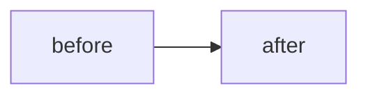

<!-- markdownlint-disable-file MD041 -- pull request descriptions start at ## headings -->
## What and why

<!-- The problem, the approach, and anything a reviewer should look at. One change per pull request: a fix, a refactor or a feature, not several. -->

## Screenshots

<!-- For changes people can see: screenshots or a GIF/recording, before and after when it helps. Put the files in docs/media/ and link them, or attach them here. Delete this section otherwise. -->

## Diagrams

<!-- For changes to structure or flow (new modules, dependencies, data flow, state machines): a Mermaid diagram. Delete this section otherwise. -->

## Verification

<!-- What you ran and what you saw: tests, builds (app, AutoFill extension), simulator or device checks. Say plainly what wasn't tested. -->

## Checklist

- [ ] `scripts/lint.sh` passes and the commit hooks ran (no `--no-verify`)
- [ ] Commit messages explain what changed and why
- [ ] Code comments describe the code, with no plan references ("Phase 1", "M2")
- [ ] New dependencies are MIT/BSD/Apache/CC0, pinned, and recorded in `THIRD_PARTY_NOTICES.md` and PLAN.md section 9b
- [ ] No code copied, translated or paraphrased from GPL projects (KeePassium, KeePassXC, KeePassDX)
- [ ] No real databases, key files or passwords in tests, screenshots or fixtures
- [ ] `main` brought in with a merge commit (`git merge --no-ff`), not a rebase
